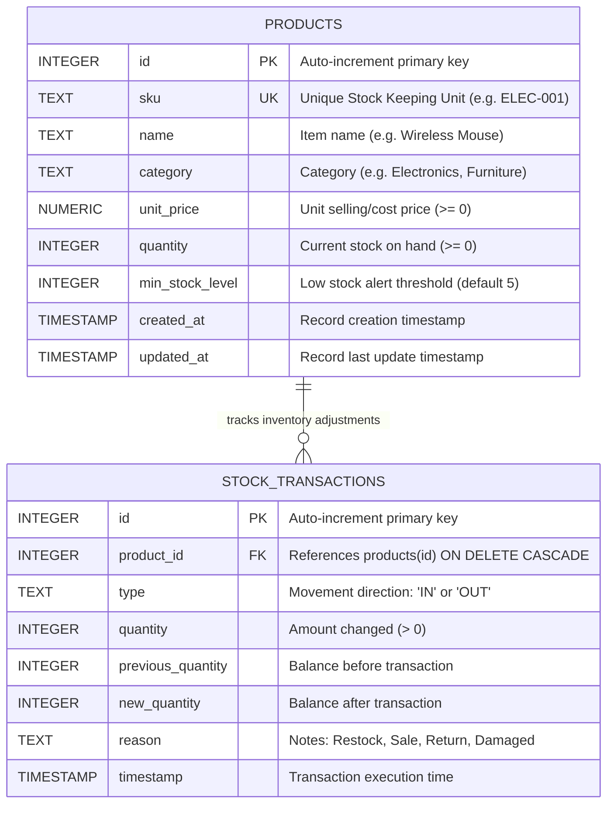

# Database Specification — Mini Inventory System
**Project:** Mini Inventory System  
**Module:** Database Layer  
**Status:** Ready for Implementation & Sharing  

---

## 1. Entity-Relationship Overview



---

## 2. Table Schemas & Constraints

### 2.1 Table: `products`
| Column | Type | Constraints | Description |
| :--- | :--- | :--- | :--- |
| `id` | `INTEGER` / `SERIAL` | `PRIMARY KEY AUTOINCREMENT` | Unique product identifier |
| `sku` | `VARCHAR(50)` | `NOT NULL UNIQUE` | Unique bar code / SKU code |
| `name` | `VARCHAR(150)` | `NOT NULL` | Descriptive name of product |
| `category` | `VARCHAR(100)` | `NOT NULL` | Classification group |
| `unit_price` | `DECIMAL(10,2)` | `NOT NULL CHECK(unit_price >= 0)` | Price per single unit |
| `quantity` | `INTEGER` | `NOT NULL DEFAULT 0 CHECK(quantity >= 0)` | Live inventory balance |
| `min_stock_level` | `INTEGER` | `NOT NULL DEFAULT 5 CHECK(min_stock_level >= 0)` | Threshold below which alert triggers |
| `created_at` | `TIMESTAMP` | `DEFAULT CURRENT_TIMESTAMP` | Row creation timestamp |
| `updated_at` | `TIMESTAMP` | `DEFAULT CURRENT_TIMESTAMP` | Row modification timestamp |

### 2.2 Table: `stock_transactions`
| Column | Type | Constraints | Description |
| :--- | :--- | :--- | :--- |
| `id` | `INTEGER` / `SERIAL` | `PRIMARY KEY AUTOINCREMENT` | Unique audit record identifier |
| `product_id` | `INTEGER` | `NOT NULL REFERENCES products(id) ON DELETE CASCADE` | Linked product foreign key |
| `type` | `VARCHAR(10)` | `NOT NULL CHECK(type IN ('IN', 'OUT'))` | Inbound (+) or Outbound (-) |
| `quantity` | `INTEGER` | `NOT NULL CHECK(quantity > 0)` | Units transferred |
| `previous_quantity`| `INTEGER` | `NOT NULL CHECK(previous_quantity >= 0)` | Balance before transaction |
| `new_quantity` | `INTEGER` | `NOT NULL CHECK(new_quantity >= 0)` | Balance after transaction |
| `reason` | `VARCHAR(255)` | `NULLABLE` | Explanation or order reference |
| `timestamp` | `TIMESTAMP` | `DEFAULT CURRENT_TIMESTAMP` | Exact time of adjustment |

---

## 3. Production DDL Script (`schema.sql`)

```sql
-- Enable foreign key support (for SQLite)
PRAGMA foreign_keys = ON;

-- 1. Create Products Table
CREATE TABLE IF NOT EXISTS products (
    id INTEGER PRIMARY KEY AUTOINCREMENT,
    sku TEXT NOT NULL UNIQUE,
    name TEXT NOT NULL,
    category TEXT NOT NULL,
    unit_price REAL NOT NULL CHECK(unit_price >= 0),
    quantity INTEGER NOT NULL DEFAULT 0 CHECK(quantity >= 0),
    min_stock_level INTEGER NOT NULL DEFAULT 5 CHECK(min_stock_level >= 0),
    created_at DATETIME DEFAULT CURRENT_TIMESTAMP,
    updated_at DATETIME DEFAULT CURRENT_TIMESTAMP
);

-- 2. Create Stock Transactions Table (Audit Ledger)
CREATE TABLE IF NOT EXISTS stock_transactions (
    id INTEGER PRIMARY KEY AUTOINCREMENT,
    product_id INTEGER NOT NULL,
    type TEXT NOT NULL CHECK(type IN ('IN', 'OUT')),
    quantity INTEGER NOT NULL CHECK(quantity > 0),
    previous_quantity INTEGER NOT NULL CHECK(previous_quantity >= 0),
    new_quantity INTEGER NOT NULL CHECK(new_quantity >= 0),
    reason TEXT,
    timestamp DATETIME DEFAULT CURRENT_TIMESTAMP,
    FOREIGN KEY (product_id) REFERENCES products(id) ON DELETE CASCADE
);

-- 3. Indexes for Fast Lookups & Reports
CREATE INDEX IF NOT EXISTS idx_products_sku ON products(sku);
CREATE INDEX IF NOT EXISTS idx_products_category ON products(category);
CREATE INDEX IF NOT EXISTS idx_products_quantity ON products(quantity);
CREATE INDEX IF NOT EXISTS idx_transactions_product ON stock_transactions(product_id);
CREATE INDEX IF NOT EXISTS idx_transactions_timestamp ON stock_transactions(timestamp DESC);
```

---

## 4. Key Analytical Queries

### 4.1 Low-Stock Alert Query
```sql
SELECT 
    id, sku, name, category, quantity, min_stock_level,
    (min_stock_level - quantity) AS units_needed
FROM products
WHERE quantity <= min_stock_level
ORDER BY quantity ASC;
```

### 4.2 Report Summary KPI Query
```sql
SELECT 
    COUNT(*) AS total_skus,
    COALESCE(SUM(quantity), 0) AS total_units_in_stock,
    COALESCE(SUM(quantity * unit_price), 0.0) AS total_inventory_valuation,
    COUNT(CASE WHEN quantity <= min_stock_level THEN 1 END) AS low_stock_count,
    COUNT(CASE WHEN quantity = 0 THEN 1 END) AS out_of_stock_count
FROM products;
```

---

## 5. Shareable Seed Data (`seed.sql`)

```sql
-- Insert Sample Products
INSERT INTO products (sku, name, category, unit_price, quantity, min_stock_level) VALUES
('ELEC-101', 'Logitech MX Master 3S Mouse', 'Electronics', 99.99, 14, 5),
('ELEC-102', 'Dell UltraSharp 27" 4K Monitor', 'Electronics', 449.50, 3, 5), -- Low stock alert
('ELEC-103', 'Mechanical Keyboard RGB', 'Electronics', 119.00, 0, 4),        -- Out of stock alert
('FURN-201', 'Ergonomic Mesh Office Chair', 'Furniture', 249.99, 8, 3),
('STAT-301', 'A5 Hardcover Dotted Notebook', 'Stationery', 12.50, 45, 10),
('STAT-302', 'Gel Ink Rollerball Pen (Pack of 12)', 'Stationery', 18.00, 2, 8); -- Low stock alert

-- Insert Initial Stock Inbound Transactions
INSERT INTO stock_transactions (product_id, type, quantity, previous_quantity, new_quantity, reason) VALUES
(1, 'IN', 20, 0, 20, 'Initial supplier delivery PO-2026-01'),
(1, 'OUT', 6, 20, 14, 'Customer order #10041'),
(2, 'IN', 5, 0, 5, 'Initial stock delivery'),
(2, 'OUT', 2, 5, 3, 'Floor display & customer pickup'),
(3, 'IN', 10, 0, 10, 'Initial delivery'),
(3, 'OUT', 10, 10, 0, 'Bulk clearance order #9822'),
(4, 'IN', 10, 0, 10, 'Warehouse transfer'),
(4, 'OUT', 2, 10, 8, 'Retail showroom orders'),
(5, 'IN', 50, 0, 50, 'Supplier shipment batch 4'),
(5, 'OUT', 5, 50, 45, 'Online store retail sale'),
(6, 'IN', 10, 0, 10, 'Supplier stock shipment'),
(6, 'OUT', 8, 10, 2, 'Back to school promo bulk order');
```
