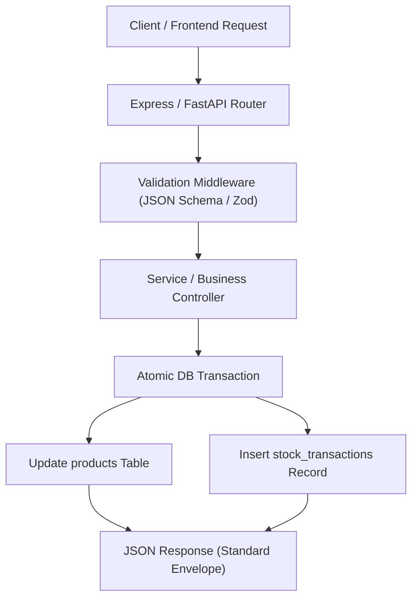

# Backend API Specification & Contract — Mini Inventory System
**Project:** Mini Inventory System  
**Module:** Backend & Business Logic Layer  
**Status:** Ready for Implementation & Sharing  
**Base URL:** `/api`  

---

## 1. Architecture & Request Pipeline



---

## 2. Standard Response Envelope

Every endpoint returns a predictable JSON response structure:

```json
{
  "success": true,
  "data": {},
  "message": "Operation completed successfully"
}
```

On error (`4xx`, `5xx`):
```json
{
  "success": false,
  "error": {
    "code": "INSUFFICIENT_STOCK",
    "message": "Cannot deduct 15 units. Only 3 units available in stock.",
    "details": null
  }
}
```

---

## 3. Product CRUD Endpoints

### 3.1 `GET /api/products`
Retrieves product list with search and filtering.

* **Query Parameters:**
  * `search` (optional): Match product name or SKU.
  * `category` (optional): Filter by category.
  * `status` (optional): `'all'` | `'in_stock'` | `'low_stock'` | `'out_of_stock'`.

* **Success Response (`200 OK`):**
```json
{
  "success": true,
  "count": 2,
  "data": [
    {
      "id": 1,
      "sku": "ELEC-101",
      "name": "Logitech MX Master 3S Mouse",
      "category": "Electronics",
      "unitPrice": 99.99,
      "quantity": 14,
      "minStockLevel": 5,
      "status": "IN_STOCK",
      "createdAt": "2026-11-20T10:00:00Z",
      "updatedAt": "2026-11-27T08:30:00Z"
    },
    {
      "id": 2,
      "sku": "ELEC-102",
      "name": "Dell UltraSharp 27\" 4K Monitor",
      "category": "Electronics",
      "unitPrice": 449.50,
      "quantity": 3,
      "minStockLevel": 5,
      "status": "LOW_STOCK",
      "createdAt": "2026-11-20T10:00:00Z",
      "updatedAt": "2026-11-27T08:30:00Z"
    }
  ]
}
```

---

### 3.2 `POST /api/products`
Creates a new product catalog item.

* **Request Body:**
```json
{
  "sku": "AUDIO-501",
  "name": "Sony WH-1000XM5 Headphones",
  "category": "Audio",
  "unitPrice": 399.00,
  "initialQuantity": 10,
  "minStockLevel": 4
}
```

* **Success Response (`201 Created`):**
```json
{
  "success": true,
  "data": {
    "id": 7,
    "sku": "AUDIO-501",
    "name": "Sony WH-1000XM5 Headphones",
    "category": "Audio",
    "unitPrice": 399.00,
    "quantity": 10,
    "minStockLevel": 4,
    "status": "IN_STOCK"
  },
  "message": "Product created successfully"
}
```

* **Error Response (`409 Conflict`):**
```json
{
  "success": false,
  "error": {
    "code": "DUPLICATE_SKU",
    "message": "A product with SKU 'AUDIO-501' already exists."
  }
}
```

---

### 3.3 `GET /api/products/:id`
Retrieves single product details along with its recent stock movement history.

* **Success Response (`200 OK`):**
```json
{
  "success": true,
  "data": {
    "id": 1,
    "sku": "ELEC-101",
    "name": "Logitech MX Master 3S Mouse",
    "category": "Electronics",
    "unitPrice": 99.99,
    "quantity": 14,
    "minStockLevel": 5,
    "status": "IN_STOCK",
    "recentMovements": [
      {
        "id": 2,
        "type": "OUT",
        "quantity": 6,
        "previousQuantity": 20,
        "newQuantity": 14,
        "reason": "Customer order #10041",
        "timestamp": "2026-11-26T14:20:00Z"
      },
      {
        "id": 1,
        "type": "IN",
        "quantity": 20,
        "previousQuantity": 0,
        "newQuantity": 20,
        "reason": "Initial supplier delivery PO-2026-01",
        "timestamp": "2026-11-20T10:00:00Z"
      }
    ]
  }
}
```

---

### 3.4 `PUT /api/products/:id`
Updates product metadata (cannot directly override quantity here; quantity must be altered via the stock movement API for audit compliance).

* **Request Body:**
```json
{
  "name": "Logitech MX Master 3S Mouse - Graphite",
  "category": "Electronics",
  "unitPrice": 94.99,
  "minStockLevel": 6
}
```

* **Success Response (`200 OK`):**
```json
{
  "success": true,
  "data": {
    "id": 1,
    "sku": "ELEC-101",
    "name": "Logitech MX Master 3S Mouse - Graphite",
    "category": "Electronics",
    "unitPrice": 94.99,
    "quantity": 14,
    "minStockLevel": 6
  },
  "message": "Product updated successfully"
}
```

---

### 3.5 `DELETE /api/products/:id`
Deletes a product and its associated transaction logs.

* **Success Response (`200 OK`):**
```json
{
  "success": true,
  "message": "Product #1 and associated transaction history deleted successfully"
}
```

---

## 4. Stock In / Stock Out Endpoint

### 4.1 `POST /api/inventory/movement`
Performs an atomic inventory adjustment and writes an audit ledger entry.

* **Request Body:**
```json
{
  "productId": 2,
  "type": "OUT",
  "quantity": 2,
  "reason": "Customer Store Sale #8812"
}
```

* **Business Logic & Validation Rules:**
  1. `quantity` must be a positive integer (`> 0`).
  2. `type` must strictly be `"IN"` or `"OUT"`.
  3. Product with `productId` must exist.
  4. **When `type === 'OUT'`:** If `product.quantity < requested_quantity`, reject immediately with `400 Bad Request`.
  5. **Transaction Execution:**
     - Calculate `previousQuantity = product.quantity`
     - If `type === 'IN'`, `newQuantity = previousQuantity + quantity`
     - If `type === 'OUT'`, `newQuantity = previousQuantity - quantity`
     - Update `products.quantity = newQuantity`
     - Insert row into `stock_transactions` table.

* **Success Response (`200 OK`):**
```json
{
  "success": true,
  "data": {
    "transactionId": 13,
    "productId": 2,
    "productName": "Dell UltraSharp 27\" 4K Monitor",
    "type": "OUT",
    "quantityDeducted": 2,
    "previousQuantity": 3,
    "newQuantity": 1,
    "isLowStock": true,
    "timestamp": "2026-11-27T12:00:00Z"
  },
  "message": "Stock adjusted successfully"
}
```

* **Error Response (`400 Bad Request` - Insufficient Stock):**
```json
{
  "success": false,
  "error": {
    "code": "INSUFFICIENT_STOCK",
    "message": "Cannot deduct 5 units. Only 3 units available in stock.",
    "currentStock": 3,
    "requestedDeduction": 5
  }
}
```

---

## 5. Reports & Low-Stock Endpoints

### 5.1 `GET /api/reports/summary`
Returns high-level business KPIs for the dashboard.

* **Success Response (`200 OK`):**
```json
{
  "success": true,
  "data": {
    "totalProducts": 6,
    "totalUnitsInStock": 71,
    "totalInventoryValuation": 6484.81,
    "lowStockCount": 2,
    "outOfStockCount": 1,
    "recentMovementsCountToday": 4
  }
}
```

---

### 5.2 `GET /api/reports/low-stock`
Returns all products currently at or below their alert threshold.

* **Success Response (`200 OK`):**
```json
{
  "success": true,
  "count": 3,
  "data": [
    {
      "id": 3,
      "sku": "ELEC-103",
      "name": "Mechanical Keyboard RGB",
      "category": "Electronics",
      "unitPrice": 119.00,
      "quantity": 0,
      "minStockLevel": 4,
      "deficit": 4,
      "status": "OUT_OF_STOCK"
    },
    {
      "id": 6,
      "sku": "STAT-302",
      "name": "Gel Ink Rollerball Pen (Pack of 12)",
      "category": "Stationery",
      "unitPrice": 18.00,
      "quantity": 2,
      "minStockLevel": 8,
      "deficit": 6,
      "status": "LOW_STOCK"
    },
    {
      "id": 2,
      "sku": "ELEC-102",
      "name": "Dell UltraSharp 27\" 4K Monitor",
      "category": "Electronics",
      "unitPrice": 449.50,
      "quantity": 3,
      "minStockLevel": 5,
      "deficit": 2,
      "status": "LOW_STOCK"
    }
  ]
}
```
