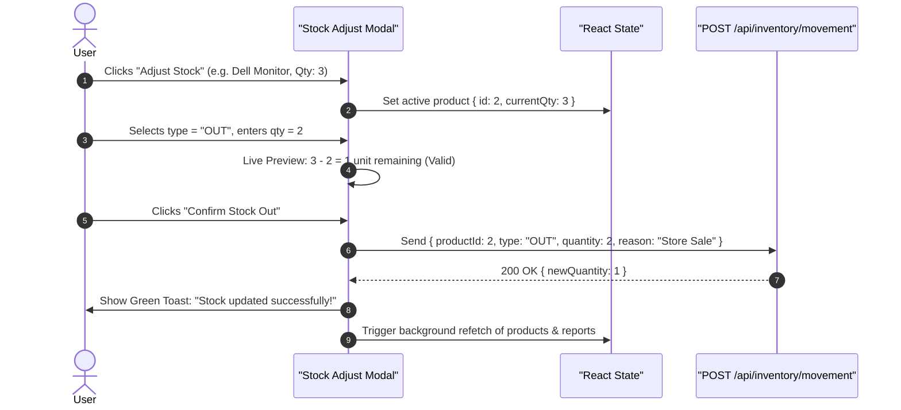

# Frontend UI Specification & Shared Types — Mini Inventory System
**Project:** Mini Inventory System  
**Module:** Frontend Client & User Experience Layer  
**Status:** Ready for Implementation & Sharing  

---

## 1. UI Page Architecture & Navigation

```
+----------------------------------------------------------------------------------------------------+
|                                    MINI INVENTORY MANAGEMENT                                       |
+----------------------------------------------------------------------------------------------------+
|  [ 📊 Dashboard & Reports ]        [ 📦 Products Catalog ]        [ 📜 Stock Movement History ]    |
+----------------------------------------------------------------------------------------------------+
|                                                                                                    |
|  PAGE 1: DASHBOARD & REPORT (Home)                                                                 |
|  ┌─────────────────────┐  ┌─────────────────────┐  ┌─────────────────────┐  ┌────────────────────┐ |
|  │ Total Products      │  │ Inventory Value     │  │ Low Stock Alert     │  │ Out of Stock Items │ |
|  │ 6 Items             │  │ $6,484.81           │  │ 2 Items ⚠️          │  │ 1 Item 🚫          │ |
|  └─────────────────────┘  └─────────────────────┘  └─────────────────────┘  └────────────────────┘ |
|                                                                                                    |
|  ⚠️ LOW STOCK ACTION PANEL (Items requiring reorder):                                              |
|  ┌───────────────────────────────────────────────────────────────────────────────────────────────┐ |
|  | SKU       | Name                         | In Stock | Threshold | Status      | Action        | |
|  | ELEC-103  | Mechanical Keyboard RGB      | 0        | 4         | [OUT STOCK] | [+ Restock]   | |
|  | STAT-302  | Gel Ink Rollerball Pen (12p) | 2        | 8         | [LOW STOCK] | [+ Restock]   | |
|  | ELEC-102  | Dell UltraSharp 27" 4K       | 3        | 5         | [LOW STOCK] | [+ Restock]   | |
|  └───────────────────────────────────────────────────────────────────────────────────────────────┘ |
|                                                                                                    |
+----------------------------------------------------------------------------------------------------+
|                                                                                                    |
|  PAGE 2: PRODUCTS CATALOG (CRUD & Stock In / Out Trigger)                                          |
|  ┌──────────────────────────────────────────────────────────────┐  ┌─────────────────────────────┐ |
|  │ 🔍 Search by name or SKU...      [ Category: All ▼ ]         │  │ ➕ Add New Product         │ |
|  └──────────────────────────────────────────────────────────────┘  └─────────────────────────────┘ |
|  ┌───────────────────────────────────────────────────────────────────────────────────────────────┐ |
|  | SKU      | Name               | Category    | Price   | Stock | Status   | Actions            | |
|  | ELEC-101 | MX Master 3S Mouse | Electronics | $99.99  | 14    | In Stock | [In/Out] [Edit] [x]| |
|  | ELEC-102 | Dell 27" 4K Mon... | Electronics | $449.50 | 3     | Low Stock| [In/Out] [Edit] [x]| |
|  └───────────────────────────────────────────────────────────────────────────────────────────────┘ |
|                                                                                                    |
+----------------------------------------------------------------------------------------------------+
```

---

## 2. Shared TypeScript Types & Data Contracts (`types.ts`)

These TypeScript interfaces can be directly shared between the Frontend and Backend:

```typescript
// Core Product Model
export interface Product {
  id: number;
  sku: string;
  name: string;
  category: string;
  unitPrice: number;
  quantity: number;
  minStockLevel: number;
  status: 'IN_STOCK' | 'LOW_STOCK' | 'OUT_OF_STOCK';
  createdAt?: string;
  updatedAt?: string;
}

// Product Form Input DTO (For Create & Edit)
export interface ProductFormData {
  sku: string;
  name: string;
  category: string;
  unitPrice: number;
  initialQuantity?: number;
  minStockLevel: number;
}

// Stock Movement Direction
export type StockMovementType = 'IN' | 'OUT';

// Stock Transaction Audit Record
export interface StockTransaction {
  id: number;
  productId: number;
  productName?: string;
  type: StockMovementType;
  quantity: number;
  previousQuantity: number;
  newQuantity: number;
  reason: string;
  timestamp: string;
}

// Payload sent to adjust stock
export interface StockMovementPayload {
  productId: number;
  type: StockMovementType;
  quantity: number;
  reason?: string;
}

// Summary Report KPI Metrics
export interface InventoryReportSummary {
  totalProducts: number;
  totalUnitsInStock: number;
  totalInventoryValuation: number;
  lowStockCount: number;
  outOfStockCount: number;
  recentMovementsCountToday: number;
}

// Low Stock Alert Item
export interface LowStockAlertItem extends Product {
  deficit: number;
}
```

---

## 3. Stock In / Stock Out Modal Component Behavior

When the user clicks the **"Adjust Stock"** button on any product row:



### Edge Case Handled in UI:
If user enters `qty = 5` when `currentQty = 3` for `OUT`:
- The modal disables the Submit button.
- Displays an inline warning: *"Cannot deduct 5 units. Maximum available to take out is 3."*

---

## 4. UI Color Palette & Badges

| State | Badge Text | Background Color | Text Color | Icon |
| :--- | :--- | :--- | :--- | :--- |
| **Healthy Stock** (`qty > min`) | `In Stock` | `#DCFCE7` (Light green) | `#15803D` (Dark green) | Checkmark |
| **Low Stock Warning** (`0 < qty <= min`) | `Low Stock` | `#FEF3C7` (Light amber) | `#B45309` (Dark amber) | Alert Triangle |
| **Out of Stock Critical** (`qty == 0`) | `Out of Stock` | `#FEE2E2` (Light red) | `#B91C1C` (Dark red) | Circle Slash |
| **Stock In Adjustment** | `Stock In (+)` | `#E0F2FE` (Light blue) | `#0369A1` (Dark blue) | Arrow Up Right |
| **Stock Out Adjustment** | `Stock Out (-)` | `#FFEDD5` (Light orange)| `#C2410C` (Dark orange)| Arrow Down Right |

---

## 5. Frontend State Management & API Hook Outline

```typescript
// Sample React Hook for Inventory Data
import { useState, useEffect } from 'react';
import { Product, InventoryReportSummary } from './types';

export function useInventory() {
  const [products, setProducts] = useState<Product[]>([]);
  const [summary, setSummary] = useState<InventoryReportSummary | null>(null);
  const [loading, setLoading] = useState<boolean>(true);

  const fetchAll = async () => {
    setLoading(true);
    try {
      const [prodRes, sumRes] = await Promise.all([
        fetch('/api/products').then(r => r.json()),
        fetch('/api/reports/summary').then(r => r.json())
      ]);
      setProducts(prodRes.data);
      setSummary(sumRes.data);
    } finally {
      setLoading(false);
    }
  };

  useEffect(() => { fetchAll(); }, []);

  return { products, summary, loading, refetch: fetchAll };
}
```
